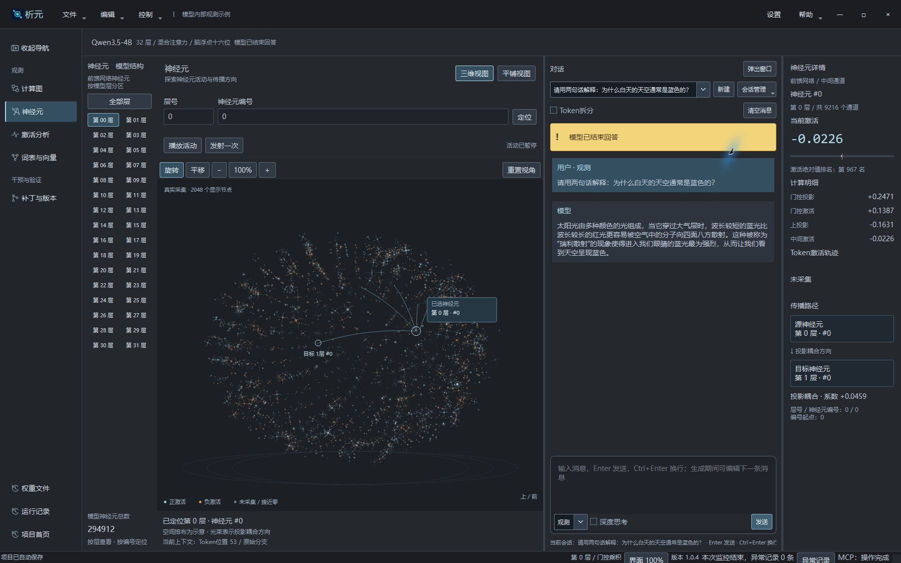
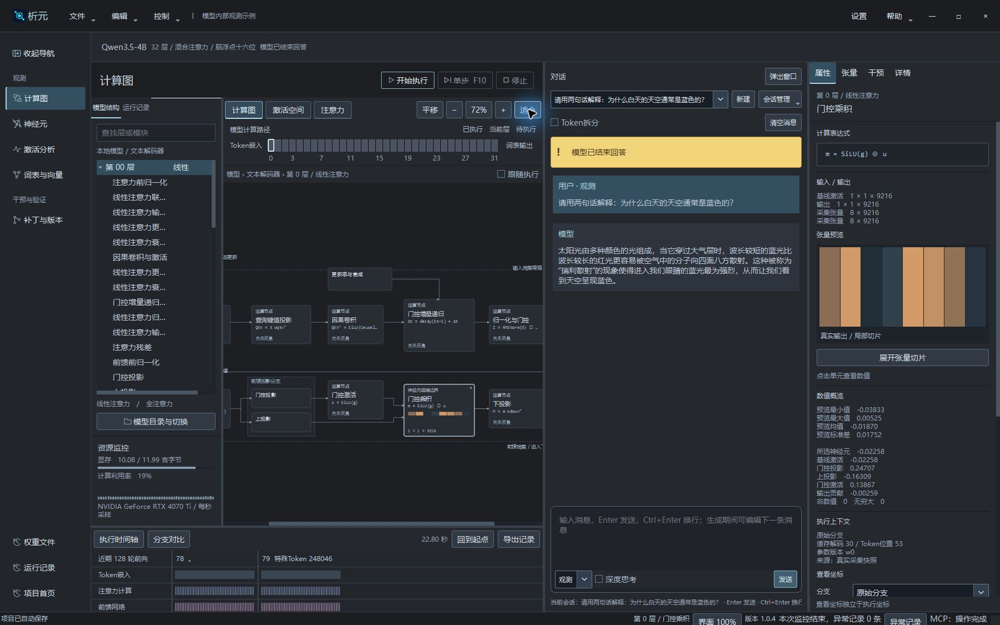
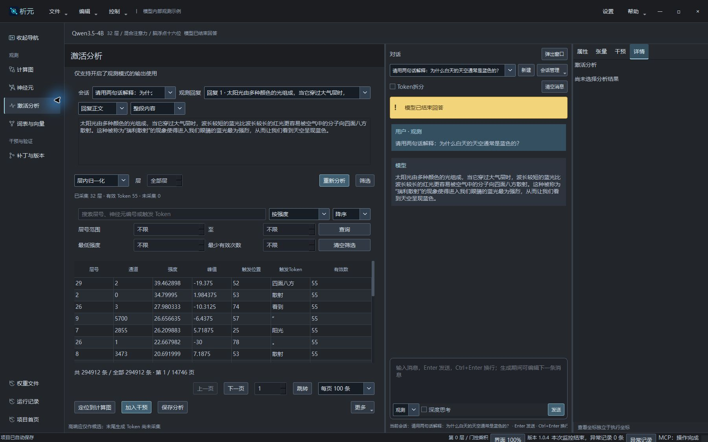
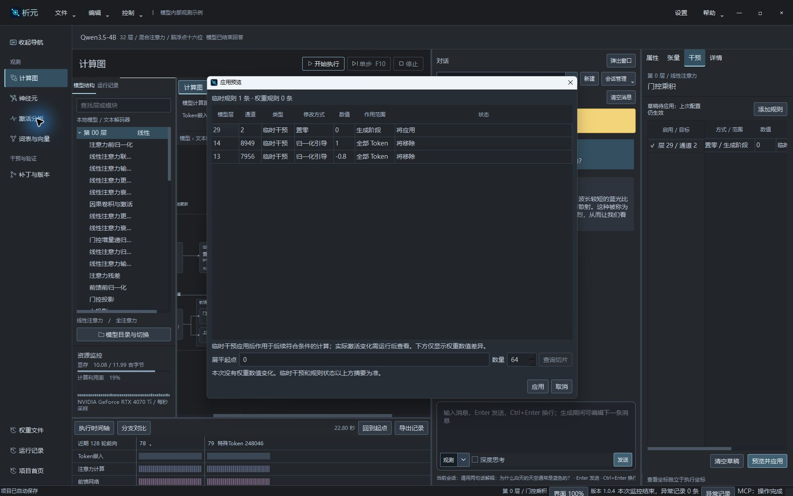

# 析元 Xiyuan

**在本地观察大模型计算，分析神经元激活，并通过干预实验探索输出变化。**

析元是一款面向 Windows 的大模型观测与实验工具。它将本地模型对话、计算图、张量数值、神经元视图和干预规则放进同一个桌面工作台，并支持通过 MCP 连接 AI 助手。

从一个问题开始，查看模型实际产生的数值，再尝试改变一个通道，比较修改前后的表现。

**神经元干预实验复现**

析元已用于复现近期网上讨论的“千问第 14 层、8949 号神经元干预实验”。通过对 Qwen3.5-4B 的指定神经元进行多档强度的归一化引导，成功观察到模型输出随干预强度发生明显变化，验证了工具的神经元定位与干预功能有效。

**免费用于非商业学习、教学与研究，欢迎提交代码贡献。采用[析元非商业源码许可证](LICENSE)。**

[功能特点](#功能特点) · [界面展示](#界面展示) · [快速开始](#快速开始) · [模型支持](#模型支持) · [MCP 接入](#mcp-接入) · [许可证](#许可证)



*Qwen3.5-4B 运行截图。选中神经元后，可查看门控投影、上投影和中间激活等数值。*

## 为什么做析元

模型给出回答后，我们往往还想继续追问：

- 这次生成经过了哪些计算？中间张量是什么样的？
- 哪些层和通道在这段内容中响应较强？
- 将一个通道置零、缩放或设为指定值，输出会怎样变化？
- 如何保存实验条件，让之后的比较有据可查？

析元希望让这些问题可以直接在桌面上探索。它适合希望了解模型内部计算的学习者、进行神经元干预实验的开发者，以及需要直观演示计算过程的教学用户。

## 功能特点

### 真实计算观测

- 加载本地模型，进行流式对话和多会话管理。
- 在观测模式中记录计算过程，浏览模型层、算子和执行时间轴。
- 查看已采集的张量切片、注意力数据、激活和输出候选等信息。
- 保存计算数值及其来源，支持运行后查询。

### 神经元与激活分析

- 提供三维和平铺视图，按层号与通道编号定位神经元。
- 查看门控、上投影、中间激活及投影耦合信息。
- 对观测回复进行激活统计，按强度、层号、通道和触发 Token 等条件筛选。
- 从分析结果定位到相应计算位置，继续查看数值或准备干预。

### 干预、对照与版本管理

- 临时激活干预支持置零、缩放、设值、加值和归一化引导。
- 区分临时干预与模型权重修改，提交前预览目标、范围和状态变化。
- 支持固定前缀与自由生成对照，查看激活、目标 Token 概率和输出差异。
- 提供补丁与版本管理、备份恢复、模型副本导出及回归验证入口。

### 词表、向量与权重文件

- 搜索 Token，查看输入嵌入与输出向量，并查询相似向量。
- 提供向量编辑预览和版本管理。
- 独立打开 Safetensors 文件或分片索引，浏览张量、读取切片及比较文件。

### MCP 与 AI 助手协作

通过 MCP，让兼容的 AI 助手查询模型状态、读取观测数据、定位神经元、分析激活，并协助组织干预和对照实验。工具操作与桌面界面同步，可在软件中查看对应位置与结果。

## 界面展示

以下展示析元 1.0.4 使用本地 Qwen3.5-4B 模型的运行界面。

### 计算工作台

将模型结构、当前层计算图、对话、张量预览和资源监控放在同一界面。可以在生成结束后继续浏览本轮已采集数据。



### 神经元观测

页首展示了神经元三维视图。可按层号和神经元编号定位，也可切换平铺视图；右侧显示选中节点的数值。

### 激活分析

对所选观测回复进行统计，查看通道强度、峰值、触发位置和有效样本数。下图展示同一次回答的 32 层激活排名。



### 干预规则预览

集中查看规则的目标层、通道、修改方式、作用范围，以及新增或移除的规则。应用临时规则后，可通过再次运行进行对照。



## 快速开始

### 1. 准备软件和模型

前往 [v1.0.4 下载页面](https://github.com/PeterRenYP/XiYuan/releases/tag/v1.0.4)，同时下载 [XiyuanSetup-1.0.4.exe](https://github.com/PeterRenYP/XiYuan/releases/download/v1.0.4/XiyuanSetup-1.0.4.exe) 和 [XiyuanSetup-1.0.4.data](https://github.com/PeterRenYP/XiYuan/releases/download/v1.0.4/XiyuanSetup-1.0.4.data)。将两个文件放在同一文件夹，双击 `.exe` 即可完成安装。安装程序会自动读取并校验配套数据包，统一安装和卸载。两个文件各小于 2 GiB，内置 Python、模型运行器和独立 MCP 服务，无需另装 Python。

下载 [SHA-256 校验文件](https://github.com/PeterRenYP/XiYuan/releases/download/v1.0.4/XiyuanSetup-1.0.4.sha256) 可核对安装文件完整性。需要研究或修改代码时，可下载[对应版本源码包](https://github.com/PeterRenYP/XiYuan/releases/download/v1.0.4/Xiyuan-1.0.4-source.zip)。

模型文件需要自行准备。请选择支持架构的完整本地模型目录，保留配置、分词器、Safetensors 权重及相应分片索引。

### 2. 创建项目

启动析元，从“文件”菜单新建项目，选择模型目录和计算设备。项目目录用于保存会话、运行记录和实验配置，应与模型目录分开。

### 3. 完成第一次观测

1. 等待模型加载完成，新建会话。
2. 将消息模式切换为“观测”。
3. 输入一个简短问题，例如：“为什么白天的天空通常是蓝色的？”
4. 生成结束后，在“计算图”和“神经元”页面查看已采集数据。
5. 打开“激活分析”，选择这次观测回复，查看候选通道。

保存运行记录后，可以添加临时规则，使用相同输入和生成条件进行对照。

## 模型支持

| 项目 | 当前范围 |
| --- | --- |
| 桌面平台 | Windows x64；当前提供 Windows 桌面构建与安装包 |
| 推理设备 | 单张 NVIDIA CUDA 显卡；CPU 可用于兼容的小模型实验 |
| 已适配架构 | Qwen2 / Qwen2.5 稠密模型，以及 Qwen3.5 稠密模型的文本计算 |
| 真实模型验证示例 | Qwen2.5-3B-Instruct、Qwen3.5-4B |
| 模型文件 | 本地 Safetensors 权重，支持单文件与分片索引 |

截图环境：**NVIDIA GeForce RTX 4070 Ti、12 GB 显存、Qwen3.5-4B、BF16**。

## MCP 接入

1. 启动析元，确认底部显示“MCP：可连接”。
2. 打开“帮助 → 安装 MCP”。
3. 复制安装提示词，交给支持 MCP 的 AI 助手完成配置。
4. 连接后，先查询客户端、项目和模型状态，再进行实验操作。

安装版的 stdio 服务入口为安装目录中的 `Xiyuan-MCP.exe`，无需启动参数。具体配置与工具说明见 [MCP 使用说明](MCP使用说明.txt)。

可以从这样的请求开始：

> 查看当前模型和观测记录，分析这次回答的激活，列出几个候选通道，并给出临时干预与对照实验方案。

## 代码结构与文件用途

### 目录说明

| 目录 | 用途 |
| --- | --- |
| [client-cpp/](client-cpp) | C++ / Qt 桌面客户端，包含工作台、神经元视图、对话、干预面板与本地 MCP 控制桥。 |
| [observatory/](observatory) | Python 模型运行器，负责推理执行、张量观测、激活干预、权重编辑与实验数据存储。 |
| [mcp_server/](mcp_server) | 标准 MCP 服务，向 AI 助手提供工具，并转发到正在运行的桌面客户端。 |
| [installer/](installer) | Windows 安装器及构建脚本，负责双文件安装包、完整性校验、更新与卸载。 |
| [tests/](tests) | 自动测试和联调脚本，覆盖数值计算、模型编辑、会话、MCP、安装与卸载。 |
| [tools/](tools) | 发布构建、公开内容检查、性能测量、存储维护与专项验证工具。 |
| [docs/images/](docs/images) | README 使用的软件界面截图。 |
| [client-cpp/assets/](client-cpp/assets) | 桌面客户端使用的产品图标。 |
| [client-cpp/licenses/](client-cpp/licenses) | Qt 相关许可证及授权例外文本。 |
| [installer/assets/](installer/assets) | 安装界面使用的软件功能配图。 |
| [installer/licenses/](installer/licenses) | 安装器所用 WebView2、Lucide 和 JSON 库的许可证与声明。 |

### 主要功能文件

| 文件 | 用途 |
| --- | --- |
| [client-cpp/main.cpp](client-cpp/main.cpp) | 创建桌面应用，处理启动参数、文件打开和验证入口。 |
| [client-cpp/workbench.cpp](client-cpp/workbench.cpp) | 协调工作台状态、模型运行、用户操作与后端事件。 |
| [client-cpp/prototypeui.cpp](client-cpp/prototypeui.cpp) | 组织桌面布局、导航、功能页面，以及帮助和关于窗口。 |
| [client-cpp/project.cpp](client-cpp/project.cpp) | 创建、打开和保存项目，管理模型选择与项目设置。 |
| [client-cpp/conversation.cpp](client-cpp/conversation.cpp) | 管理会话、流式对话，以及嵌入和独立聊天窗口。 |
| [client-cpp/neurons.cpp](client-cpp/neurons.cpp) | 绘制神经元三维和平铺视图，处理定位、激活颜色与投影光束。 |
| [client-cpp/rules.cpp](client-cpp/rules.cpp) | 编辑神经元干预规则，生成预览并提交到模型运行器。 |
| [client-cpp/features.cpp](client-cpp/features.cpp) | 展示激活分析、词表向量、补丁版本与回归验证页面。 |
| [client-cpp/weightfilewindow.cpp](client-cpp/weightfilewindow.cpp) | 提供独立 Safetensors 权重文件的浏览、比较、编辑和恢复窗口。 |
| [client-cpp/transport.cpp](client-cpp/transport.cpp) | 启动 Python 工作进程，收发命令、事件和分块数据。 |
| [client-cpp/mcpbridge.cpp](client-cpp/mcpbridge.cpp) | 将 MCP 操作接入客户端状态、界面与实际操作流程。 |
| [client-cpp/anomalyengine.cpp](client-cpp/anomalyengine.cpp) | 在独立监控进程中分析采样指标并产生异常事件。 |
| [client-cpp/anomalycontroller.cpp](client-cpp/anomalycontroller.cpp) | 管理异常监控连接、提示窗口、忽略操作与异常记录。 |
| [observatory/worker.py](observatory/worker.py) | 接收运行命令，执行模型生成、会话处理与功能调用。 |
| [observatory/model.py](observatory/model.py) | 检查本地模型，提供 Qwen2 系列分操作执行与采样逻辑。 |
| [observatory/qwen35.py](observatory/qwen35.py) | 适配 Qwen3.5 混合注意力结构及缓存推理。 |
| [observatory/neurons.py](observatory/neurons.py) | 采集和查询神经元数值，计算跨层投影耦合。 |
| [observatory/editing.py](observatory/editing.py) | 应用激活与权重干预，事务保存模型并管理备份恢复。 |
| [observatory/features.py](observatory/features.py) | 执行激活统计、向量查询、模型导出与回归验证。 |
| [observatory/versions.py](observatory/versions.py) | 管理补丁版本、撤销重做及权重和分词器的一致性提交。 |
| [observatory/traces.py](observatory/traces.py) | 保存和读取运行事件、张量数值及离线观测记录。 |
| [observatory/token_analysis.py](observatory/token_analysis.py) | 保存采样证据，关联回复中的 Token、概率与激活记录。 |
| [observatory/weightfiles.py](observatory/weightfiles.py) | 读取 Safetensors 文件及分片，执行切片、比较和事务编辑。 |
| [mcp_server/server.py](mcp_server/server.py) | 注册 MCP 工具并运行标准输入输出服务。 |
| [mcp_server/bridge.py](mcp_server/bridge.py) | 发现本机客户端，通过本地连接调用控制桥。 |
| [installer/setup.cpp](installer/setup.cpp) | 实现原生安装宿主、双文件校验解包、更新、回滚与卸载。 |
| [installer/build.py](installer/build.py) | 编译安装宿主、压缩载荷并生成两个配套安装文件。 |
| [installer/prepare_dependencies.py](installer/prepare_dependencies.py) | 下载并校验安装器所需的固定版本构建依赖。 |

### 启动、配置与构建文件

| 文件 | 用途 |
| --- | --- |
| [main.py](main.py)、[launcher.py](launcher.py) | 提供 Python 兼容启动入口、工作进程分流与启动错误日志。 |
| [runtime_launcher.py](runtime_launcher.py) | 启动 C++ 客户端配套的推理、监控或权重文件工作进程。 |
| [run_mcp.py](run_mcp.py)、[mcp-codex.toml](mcp-codex.toml) | 提供 MCP 服务入口及 Codex 配置示例。 |
| [setup.ps1](setup.ps1)、[setup-native.ps1](setup-native.ps1)、[setup-mcp.ps1](setup-mcp.ps1) | 准备 Python 推理环境、Qt 编译工具链与独立 MCP 环境。 |
| [build.ps1](build.ps1)、[build-native.ps1](build-native.ps1)、[tools/release.py](tools/release.py) | 执行客户端编译、运行器和 MCP 打包，生成完整分发目录。 |
| [start.ps1](start.ps1)、[register-mcp.ps1](register-mcp.ps1) | 启动软件，以及向 Codex 注册源码模式的 MCP 服务。 |
| [client-cpp/CMakeLists.txt](client-cpp/CMakeLists.txt) | 定义客户端、异常监控进程与验证程序的构建目标。 |
| [runtime-cpp.spec](runtime-cpp.spec)、[mcp-standalone.spec](mcp-standalone.spec) | 配置 PyInstaller 分别打包模型运行器与独立 MCP 服务。 |
| [requirements-runtime.txt](requirements-runtime.txt)、[requirements-ui.txt](requirements-ui.txt)、[requirements-mcp.txt](requirements-mcp.txt)、[requirements-dev.txt](requirements-dev.txt)、[requirements-lock.txt](requirements-lock.txt) | 声明运行、兼容界面、MCP、开发和固定版本依赖。 |
| [tools/native_manifest.py](tools/native_manifest.py)、[tools/audit_publication.py](tools/audit_publication.py) | 生成分发清单和许可证文件，检查拟公开源码。 |
| [.gitignore](.gitignore)、[LICENSE](LICENSE) | 定义 Git 上传排除规则，以及本项目的非商业使用和贡献授权。 |

## 从源码构建

开发环境使用 **Windows x64、Python 3.12、Qt 6.8.3、MinGW 13.1、CMake 和 Ninja**。在源码根目录打开 PowerShell，执行以下命令。首次准备需要联网下载 Python 依赖和 Qt 工具链。

```powershell
# 准备 Python、推理依赖和原生编译工具。
.\setup.ps1
.\setup-native.ps1

# 准备独立 MCP 服务及其打包环境。
.\setup-mcp.ps1 -Build

# 编译客户端、监控进程，打包模型运行器和 MCP 服务。
.\build.ps1

# 启动完整分发版。
.\start.ps1
```

完整软件目录为 `dist/ModelObservatoryCpp/`，入口为 `Xiyuan.exe`。只修改 C++ 客户端时，可执行 `.\build.ps1 -SkipRuntime`，复用已经生成的模型运行器和 MCP 服务。源码模式注册 MCP 可执行 `.\register-mcp.ps1`，脚本会自动填写当前源码路径。

### 构建双文件安装包

完整软件目录生成后，执行：

```powershell
.\.venv\Scripts\python.exe installer/build.py
```

安装器会自动准备 WebView2 SDK **1.0.2903.40**、nlohmann/json **3.11.3**、Lucide **0.468.0**，并校验固定版本依赖的 SHA-256。微软 Evergreen 运行库引导程序从官方地址获取。依赖保存在 `.cache/` 中；可提前执行以下命令完成下载：

```powershell
.\.venv\Scripts\python.exe installer/prepare_dependencies.py
```

生成文件为 `dist/XiyuanSetup-1.0.4.exe`、`dist/XiyuanSetup-1.0.4.data` 和 `dist/XiyuanSetup-1.0.4.sha256`。安装包包含项目 `LICENSE` 及 `third-party-notices/` 中的第三方声明。

### 验证与目录说明

```powershell
# 使用本地微型模型验证核心逻辑。
.\.venv\Scripts\python.exe -m pytest tests/test_core.py

# 验证桌面界面，报告和截图写入独立目录。
$env:QT_QPA_PLATFORM = 'offscreen'
.\dist\ModelObservatoryCpp\Xiyuan.exe --verify-ui-v2 artifacts/source-ui-check
```

源码位于 `client-cpp/`、`observatory/`、`mcp_server/`，安装器位于 `installer/`。`work/` 为构建中间目录，`dist/` 为发布产物，`artifacts/` 为验证输出，均由脚本生成。真实大模型联调脚本使用本机模型目录；运行前请按自己的模型存放位置调整路径，并为权重修改测试准备独立副本。

## 参与项目

欢迎通过 Issues 提交问题、使用反馈和模型适配建议。报告问题时，请附上软件版本、模型名称、运行设备、复现步骤和相关错误信息。

欢迎通过 Pull Request 提交修复、优化和新功能。贡献者保留自身贡献的著作权，提交贡献时同意按[本项目许可证](LICENSE)授权，并说明所包含第三方材料的来源及许可证。

实现使用 C++ / Qt 桌面客户端，以及 Python / PyTorch / Transformers 模型运行器。主要代码位于 [client-cpp](client-cpp)、[observatory](observatory) 和 [mcp_server](mcp_server)，验证代码位于 [tests](tests)。

## 许可证

本项目采用 **[析元非商业源码许可证 1.0](LICENSE)**，以源码可用的方式发布。

- **免费学习与研究**：允许非商业学习、教学、研究，以及相应的使用和修改。
- **欢迎共同改进**：支持提交代码贡献，贡献者保留版权，贡献按同一许可证发布。
- **修改版提供源码**：免费分发修改版时，提供对应源码，保留版权与许可证，并标明改动。
- **禁止商业利用**：禁止销售软件或修改版、集成到收费或商业产品、提供付费服务，以及用于其他商业或盈利活动。

完整授权条件见 [LICENSE](LICENSE)。第三方组件和模型权重分别遵循各自的许可证。
